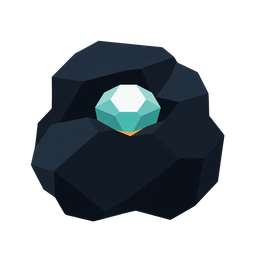

<p align="center">
  
</p>

<h1 align="center">COAL</h1>
<p align="center"><b>Cognitive Orchestration AI Layer</b></p>
<p align="center">A record of your work that you own and any AI tool can read.</p>
<p align="center"><a href="https://coalmine.io">coalmine.io</a></p>
<p align="center">
  <a href="https://github.com/calebtonn/coal/stargazers"></a>
  <a href="LICENSE"></a>
  
</p>

I use Claude, ChatGPT, Cursor and Claude Code in the same week. Each one produces things: an HTML page, a script, a plan, a decision. Each one forgets what I was doing when the session ends. Last week I spent twenty minutes scrolling through chats looking for a budget tracker I had built, because the only way to find it was to remember which conversation it was in.

COAL keeps a record of that work outside any one tool. For each thing you were working on it stores:

- the intent, in your own words
- the artifacts, content-addressed, with which tool and model produced them
- the state: last activity, next step, open questions

It runs on your machine. The record is a folder of JSON files you can read with any editor. Any tool that speaks MCP can search it and write to it. Start a new session in a folder that has a record and the next step is on screen before you type. Start it with `coal resume` and the first thing the tool says is where you left off.

## Status

Pre-alpha, and being built in the open. There is no release and no install path yet; `coal` is built from source with `make GO=/path/to/go build`, which needs Go 1.27 and git and puts the binary at `.sandbox/bin/coal`. `main` holds the spec, the decisions behind it, the task list (`docs/05-MVP-TASKS.md`) and the Phase 1 implementation in Go. The code began as Dave Nicoll's proof of concept on the `poc/go` branch; ADR-018 adopted it as the implementation, and it has been on `main` since 2026-11-07. It runs the demo from a recorded Claude Code session: capture through the hooks, find over MCP and from the CLI, the resume line at session start, and `coal resume`. It was run once against a live Claude Code session on macOS on 2026-11-07: the hooks captured a manifest, the model recorded state over MCP, a plain new session offered to continue, and `coal resume` resumed. Nine bugs from that run are open as issues #20 to #28, among them three Go test packages that fail on macOS. The web UI depends on a package that is not published, so `make web` works only with the sibling checkout; without it the binary still builds and serves a placeholder page at `/`. [`docs/02-SPEC.md`](docs/02-SPEC.md) is the spec, [`docs/06-DECISIONS.md`](docs/06-DECISIONS.md) holds the decisions, and [`docs/poc/STATUS.md`](docs/poc/STATUS.md) is the build log. If you want to follow along or help, read the spec, look through the code, and open an issue where something is wrong or unclear. [CONTRIBUTING.md](CONTRIBUTING.md) has the rest.

## Build it

You need Go 1.27 and git. The demo scripts also need GNU bash 4+, GNU coreutils, `jq`, `curl` and `python3`; on macOS, `brew install bash coreutils jq` and put them first on `PATH`. The Makefile looks for Go at `~/.local/go/bin/go`; point `GO=` at yours if it lives elsewhere.

```
make GO=/path/to/go build               # builds .sandbox/bin/coal
make GO=/path/to/go test                # three packages fail on macOS today (#22, #23, #24)
SKIP_BUILD=1 make GO=/path/to/go demo   # the five definition-of-done steps in a fresh .sandbox/demo-*/
```

Run the binary with `COAL_HOME` set, or pass `--home`:

```
export COAL_HOME=$PWD/.sandbox/coal
.sandbox/bin/coal init
.sandbox/bin/coal version               # coal 0.1.0-poc and the Go version
.sandbox/bin/coal find budget
```

The web UI does not build from a fresh clone. `make web`, `make e2e` and the demo's step 5 need Bun and `../web-framework`, a checkout of `@davenicoll/web-framework` next to this repo, and that package is not published (#26). Without it, run the demo as `SKIP_BUILD=1 make demo` after `make build`: steps 1 to 4 pass, step 5 fails on the UI check, and `http://127.0.0.1:4242` serves a page saying the UI is not built.

## Layout

```
coal/
  CLAUDE.md                     Instructions for Claude Code
  CONTRIBUTING.md               How to help now
  Makefile                      Build, test and demo targets
  go.mod                        The one Go module
  assets/                       Icon: icon.png plus 16 to 512 px sizes
  cmd/coal/                     The one binary: CLI, daemon, MCP server, hooks
  docs/
    01-THESIS.md                Why this exists, one page
    02-SPEC.md                  MVP functional spec
    03-ARCHITECTURE.md          Components, data flow, diagrams
    04-INTENT-MANIFEST.md       The open standard (v0.1)
    05-MVP-TASKS.md             Ordered build tasks with acceptance criteria
    06-DECISIONS.md             Architecture decision records
    poc/                        PLAN, STATUS and DEMO for the implementation
  internal/                     The library: app, capture, daemon, fold, importer, index,
                                manifest, marker, mcpserver, metrics, paths, queue, store, summarize
  spec/
    intent-manifest.schema.json JSON Schema for the manifest, embedded in the binary
    examples/                   Example manifests
  web/                          Web UI: Svelte 5, built with Bun, embedded in the binary
  scripts/                      Demo, session replay, MCP smoke test, sandbox guard
  site/                         coalmine.io: the one-page site and the script that publishes it with the schema from spec/
  testdata/claude-code/         Recorded hook payloads and transcripts
```

One binary. `coal` is the whole thing: CLI, daemon, MCP server and hooks, built from `cmd/coal`. The library lives under `internal/`. I will split a package out only if someone else needs one piece on its own.

## What the MVP covers

Capture comes from Claude Code only. Cursor, Codex CLI and Gemini CLI have lifecycle hooks too, but one adapter is enough to test whether the record is worth keeping (ADR-011). The case that started this (a page buried in a claude.ai chat) is handled in the MVP by running `coal add` on a downloaded file. Browser capture comes in Phase 2. The MVP shows that the record and the resume work with one harness. It does not yet show that capture works everywhere.

## Phases

The MVP is Phase 1. Phases 2 through 5 describe where this goes if Phase 1 holds up. Each one starts only after the retro on the one before it. Phase 5 is a proposal (ADR-017), and a small part of it may land earlier. Phase 1 has a date. The others do not.

| Phase | Name | Status | What it has to show |
|---|---|---|---|
| 1 | Record | MVP, in progress | A record captured in one tool can be read back and resumed in another, with sessions attached to the right intent |
| 2 | Reach | Not started | Capture works from every coding agent with hooks and from chat apps, which have none |
| 3 | Attention | Not started | The record plus simple rules is enough to surface the right thing at the right time |
| 4 | Portability | Not started | Someone else's software writes manifests that work here |
| 5 | Places | Proposed | An area of work opens from one place, with its tools and next step |

### Phase 1: Record (the MVP, six weeks)

- Intent Manifest v0.1, with a published schema, an example and a validator
- Claude Code hooks: capture on write, queue the summary at session end
- Resume: the next step on screen before you type; `coal resume` opens the session from it
- History: `~/.coal/` is a git repo, committed by the daemon
- MCP server, `coal` CLI, local web UI
- One binary, `coal`, with the library under `internal/`

Done when: the week six retro. If I have not reached for it unprompted at least five times in a week, I stop.

### Phase 2: Reach

- Cursor and Codex adapters on the Phase 1 capture contract
- `coal import` (ADR-012): build manifests from session logs already on disk and from claude.ai and ChatGPT exports (a first version, `coal import claude-code`, already exists)
- Browser capture from claude.ai and chatgpt.com, if import is not enough
- Code provenance by reference to Agent Trace (ADR-015)
- Semantic search with a local embedding model
- Raycast extension as the entry point

Done when: a manifest written by something other than Claude Code is found and resumed from a third tool.

### Phase 3: Attention

- Signals: calendar, git activity, IDE focus, time of day
- Surfacing by context instead of search
- Policy engine: editable rules; the user's overrides are the training signal
- Interrupt gating for Slack and chat
- Menu bar app for notifications and launching

Done when: surfaced items get opened more often than dismissed, and nobody has turned surfacing off.

### Phase 4: Portability

- Spec v1.0 with a second implementer
- Encrypted multi-device sync
- Export and import between stores
- Optional adapter for a preferences store such as OpenMemory
- Org install and fleet config, open source like everything else

Done when: a manifest written by software this repo did not produce validates and resumes here.

### Phase 5: Places (proposed, ADR-017)

- A name and an icon for each area of work, such as the home budget or a video
- Areas that stay open, with projects inside them through `partOf`
- A kit of entry points: chats, MCP servers, and links to docs, data, planners, notes, and files that open in apps outside AI, such as a Final Cut Pro library
- Large files, such as video exports, kept by reference instead of copied (the schema change lands by spec v1.0)
- Opt-in folder watching, so work in apps without hooks still updates the record
- `coal open` and launchers that bring up the kit, the active projects and the next step together
- MCP servers attached on open where the tool allows it, and listed as links where it does not

Done when: at the retro after a month of use, most work on the home budget and one other area started from their place, and nothing in their kits had to be set up again by hand.

## Principles

- Local first. Your data lives in `~/.coal/`. There is no account.
- Files are the truth. Manifests are plain JSON. SQLite is an index that can be deleted and rebuilt.
- The schema is the product. The daemon is one implementation of it.
- Rules about attention, interruption and routing belong to the user and are readable by the user.

## License

Apache 2.0. See [LICENSE](LICENSE). All of it is open source: the schema, the library, the CLI, every adapter, and the policy engine when it exists. No paid tier.
