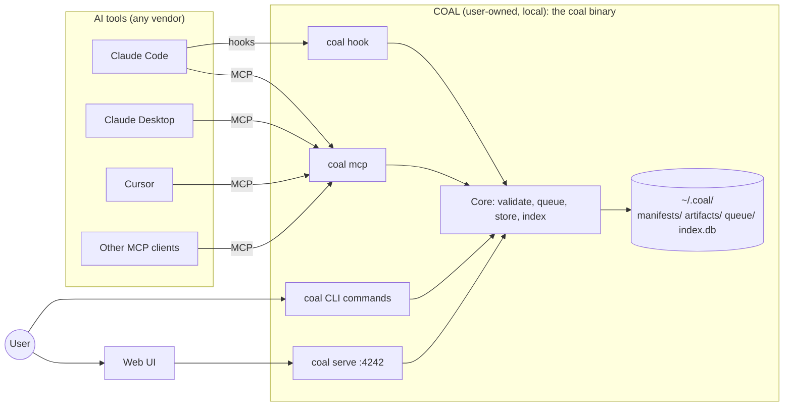
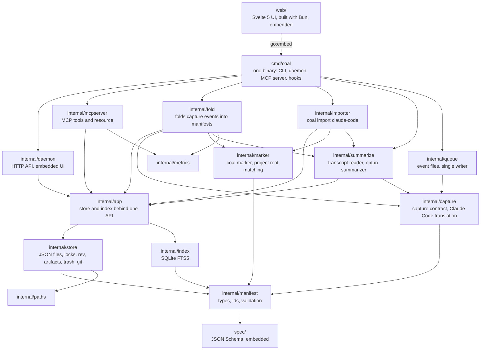
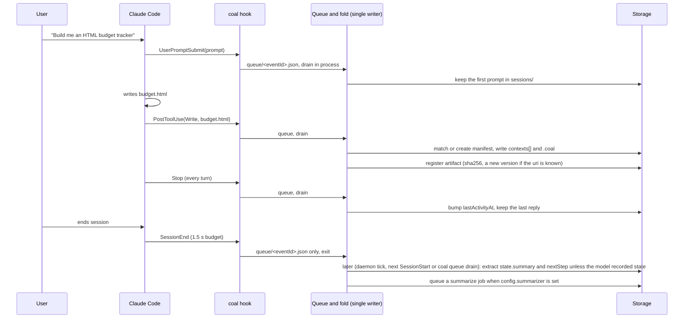
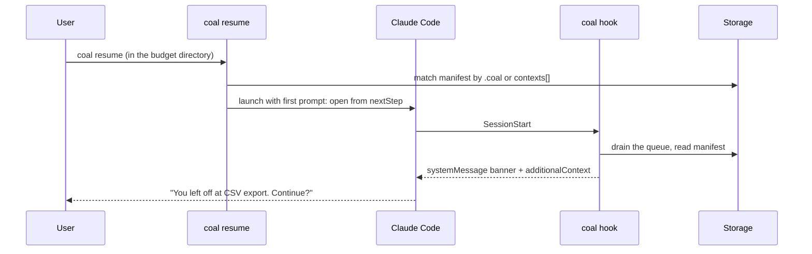
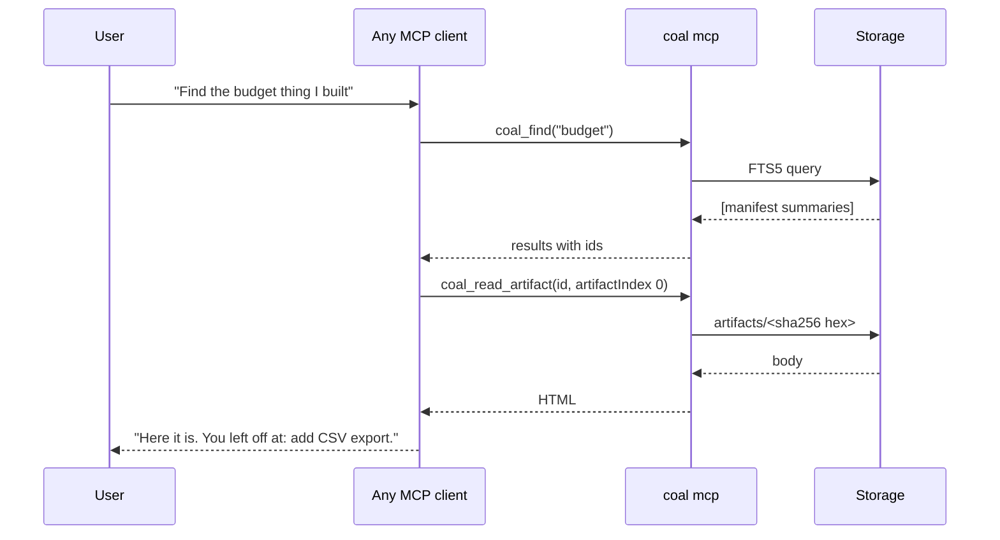
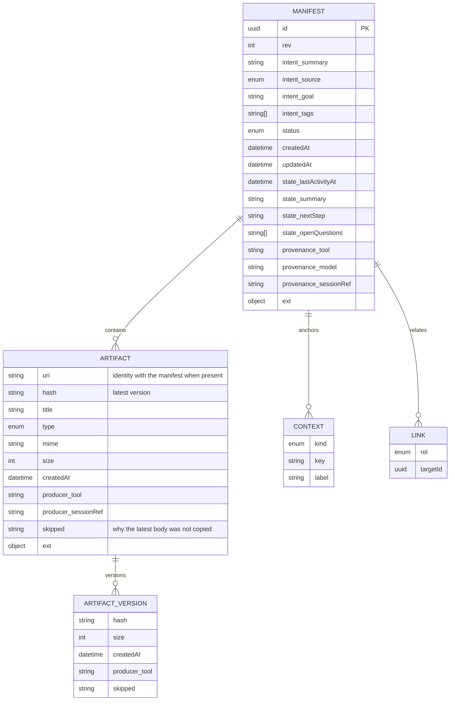
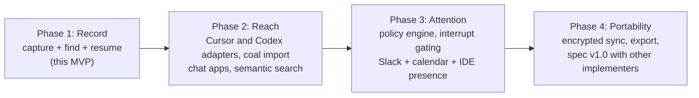

# Architecture

## Where COAL sits

Every AI tool reads and writes the same layer. No tool owns it. The user can open the directory and read everything with no software. Hooks write to storage through the `coal` binary, never through the MCP server: the MCP server is how a model reads and records on purpose, the hooks are how capture happens without the model doing anything.

## Package dependency graph

One Go module, one binary (ADR-018). `cmd/coal` holds the cobra commands; the daemon, MCP server and hooks are subcommands of it, not separate programs. Everything under `internal/` is private to the module. `spec/` holds the JSON Schema and embeds it so the binary validates with the same file the spec publishes. `web/` holds the Svelte 5 UI, built with Bun and embedded with `go:embed`. `internal/manifest` depends on nothing else in the repo but `spec/`; `internal/app` puts the store and the index behind one API that the CLI, daemon, MCP server and fold all use, so there is one place where a write validates, locks, bumps `rev`, updates the index and records history.

## Capture flow (Claude Code)

Hooks never run git. A hook opens the store with deferred history, so each write touches `.history-pending`; the daemon tick, `coal queue drain` or any non-hook command commits `manifests/` in a batch under the store-wide `.git.lock` once that marker has been quiet for two seconds (ADR-014).

## Resume flow

Plain `claude` without the launcher gets the banner and context from the hook, and the first reply (after the user types anything) opens by offering to continue.

## Find and resume flow (any tool)

## Data model

Storage is file-first. The ER diagram describes the shape, not a relational schema. An artifact with a `uri` is identified by (manifest, `uri`) and its history is `versions[]`, oldest first; one without a `uri` is identified by its hash; the top-level artifact fields always describe the latest version. SQLite holds only an FTS5 virtual table plus a thin lookup table keyed by manifest id, both rebuildable.

## Why these choices

| Decision | Reason |
|---|---|
| Local-first, files as truth | The thesis is user ownership. If it needs our server, it is not user-owned. |
| JSON manifests, one per file | Human-readable, git-able, trivially portable, diffable. |
| SQLite FTS5 | Zero-dependency full-text search, fast enough for years of use on one machine. |
| MCP as the primary interface | It is the one protocol every AI tool is adopting. Building to it means COAL works with tools that do not exist yet. |
| Claude Code hooks for first capture | Deterministic lifecycle hooks, no browser hacks. Cursor, Codex CLI and Gemini CLI have hooks too; one adapter is enough to test the record, and the capture contract in ADR-011 keeps the next ones cheap. |
| Go, one binary (ADR-018, supersedes ADR-005) | The proof of concept on `poc/go` ran the whole definition of done, so main adopted it on 2026-11-07. One static binary with pure-Go SQLite (no cgo) is what hooks that must finish in milliseconds, a daemon and an MCP server all want; there is no runtime or native build to install. |
| Artifacts identified by (manifest, uri) with `versions[]` (ADR-019) | A file that is edited again is the same artifact with a new version, not a second artifact. Every addition to schema 0.1 for this (`rev`, `versions[]`, `skipped`, artifact `ext`) is optional, so simple readers keep using the top-level fields. |

## Phase map

The whiteboard's Sense / Model / Decide / Act loop is Phase 3. The MVP is the storage and interface it will run on.
