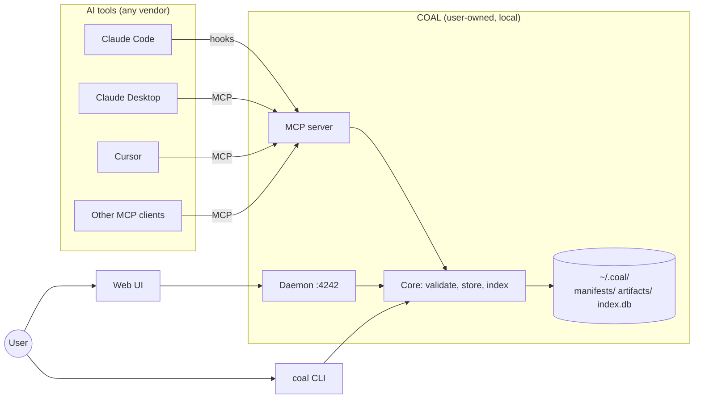
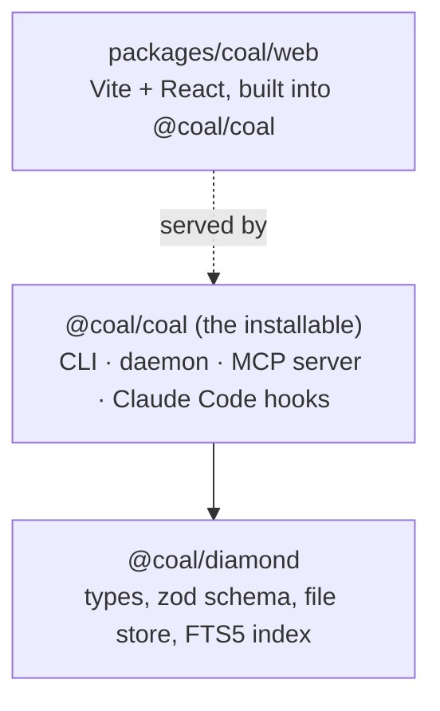
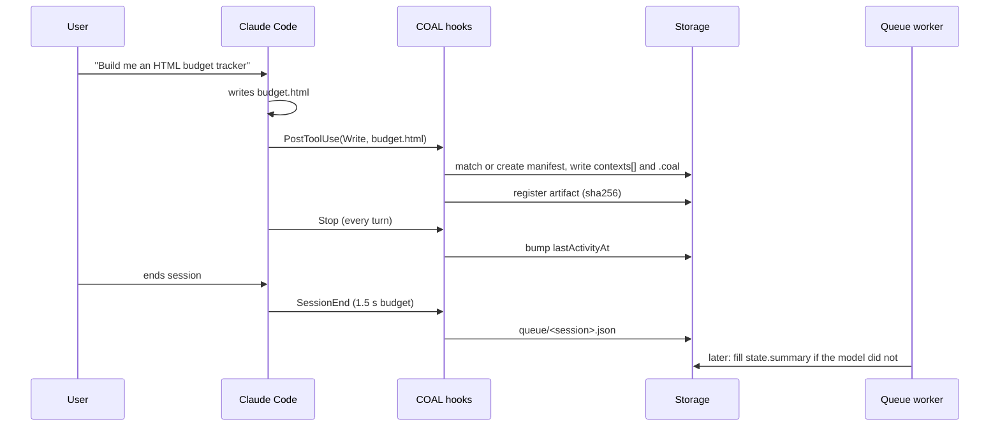
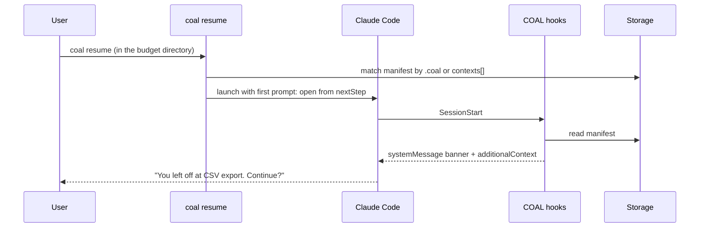
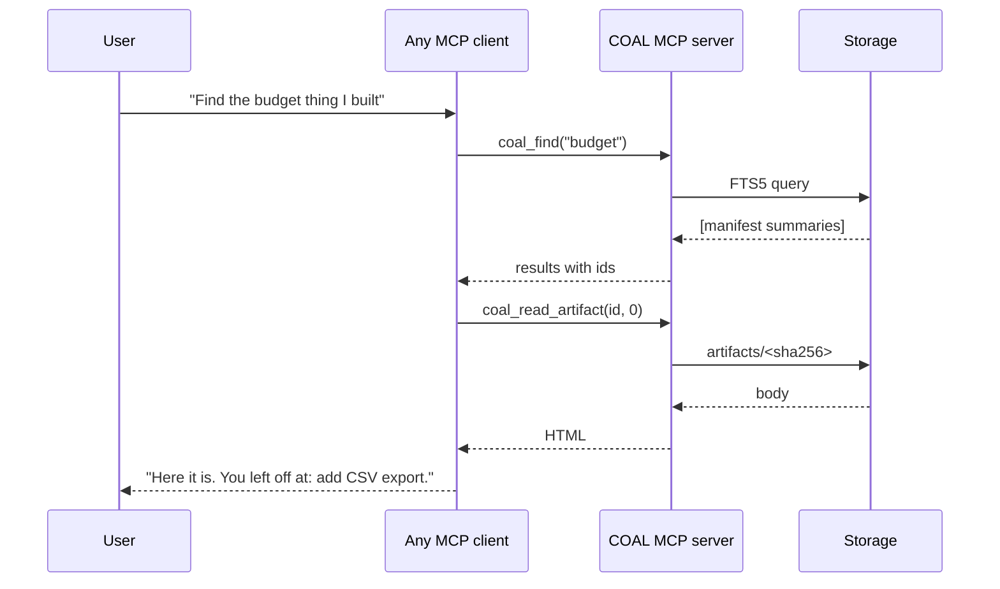
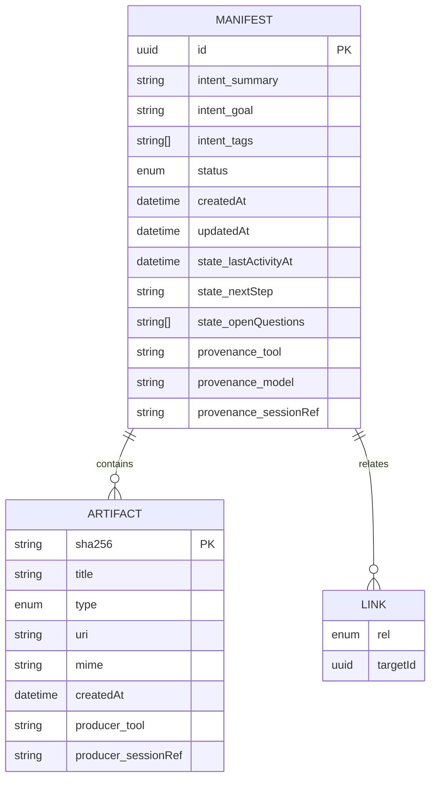
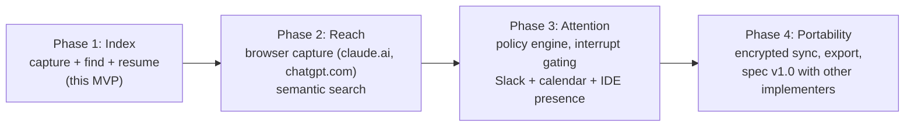

# Architecture

## Where COAL sits

Every AI tool reads and writes the same layer. No tool owns it. The user can open the directory and read everything with no software.

## Package dependency graph

Two packages. `diamond` has no runtime dependency on anything else in the repo. `coal` is everything the user installs. The daemon, MCP server and hooks are subcommands of one binary, not separate packages; they split out only when a second implementer needs one on its own.

## Capture flow (Claude Code)

## Resume flow

Plain `claude` without the launcher gets the banner and context from the hook, and the first reply (after the user types anything) opens by offering to continue.

## Find and resume flow (any tool)

## Data model

Storage is file-first. The ER diagram describes the shape, not a relational schema. SQLite holds only an FTS5 virtual table plus a thin lookup table keyed by manifest id, both rebuildable.

## Why these choices

| Decision | Reason |
|---|---|
| Local-first, files as truth | The thesis is user ownership. If it needs our server, it is not user-owned. |
| JSON manifests, one per file | Human-readable, git-able, trivially portable, diffable. |
| SQLite FTS5 | Zero-dependency full-text search, fast enough for years of use on one machine. |
| MCP as the primary interface | It is the one protocol every AI tool is adopting. Building to it means COAL works with tools that do not exist yet. |
| Claude Code hooks for first capture | Deterministic lifecycle hooks, no browser hacks. Cursor, Codex CLI and Gemini CLI have hooks too; one adapter is enough to test the record, and the capture contract in ADR-011 keeps the next ones cheap. |
| TypeScript | MCP SDK, Claude Code hook ecosystem, and the web UI all live there. One language, one toolchain. |

## Phase map

The whiteboard's Sense / Model / Decide / Act loop is Phase 3. The MVP is the storage and interface it will run on.
